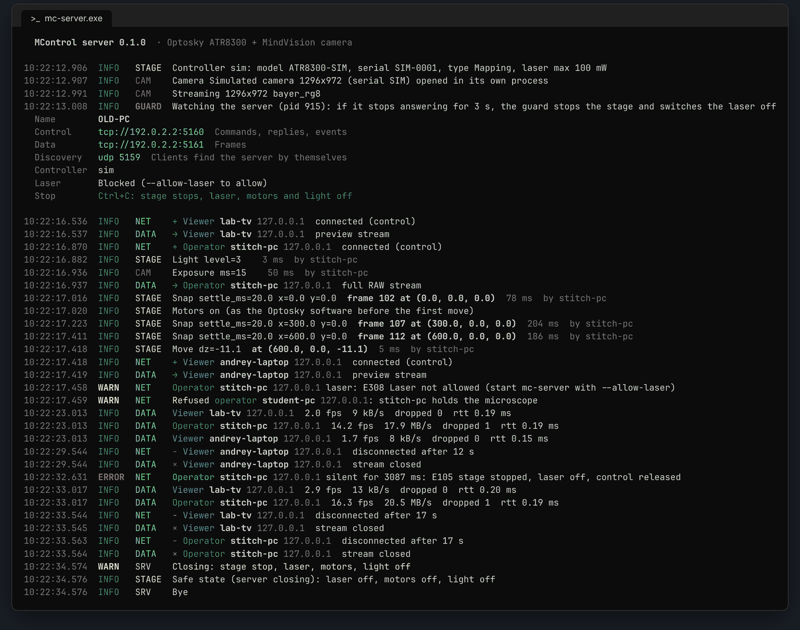

# MControl

Control an **Optosky ATR8300** microscope (stage, focus, light, laser, TEC) and its **MindVision** camera over the LAN, from Python.

```
 old PC (wired to the instrument)            new PC (operator)               other PCs
 ┌──────────────────────────────┐   TCP     ┌──────────────────────┐        ┌──────────┐
 │ mc-server.exe                │◄─────────►│ Python: Microscope() │        │ Viewer() │
 │  ├ camera worker (process)   │  control  │  full RAW frames      │        │ previews │
 │  ├ guard (process)           │  + data   └──────────────────────┘        └──────────┘
 │  └ controller on COM         │
 └──────────────────────────────┘
```

* **One exe** on the microscope PC, nothing to install there apart from the MindVision SDK. A colour log shows who is connected and what is sent.
* **Full resolution, fast.** Raw Bayer frames are sent as the sensor gives them: no conversion on the old PC. Each frame carries the stage position at mid-exposure and the time on the shared clock.
* **One operator, many viewers.** The operator holds a lease. Viewers are read-only and get small JPEG previews, encoded once per frame and shared by all of them.
* **Safe.** If the operator goes silent, the stage stops and the laser goes off. A separate guard process does the same over COM if the server itself hangs or dies.
* **Stable client.** The Python client finds the server and remembers it, and reconnects by itself. It repeats a command after a reconnect only when repeating is harmless (`goto`, settings, reads); relative moves are never repeated.

## Quick start

**Microscope PC (Windows 10)**
1. Install the MindVision SDK (`MindVision Platform Setup`, <https://www.mindvision.com.cn>).
2. Close the Optosky software: it holds the COM port and the camera.
3. Download `mc-server.exe` from [Releases](../../releases) and run it:
   ```
   mc-server.exe                  # finds the controller on its own
   mc-server.exe --port COM4      # or name the port
   mc-server.exe --sim            # simulator, no hardware
   mc-server.exe --help
   ```
   Ctrl+C stops it. Before exiting it stops the stage and switches off the laser, motors and light.

   

**Operator PC** (with [uv](https://docs.astral.sh/uv/))
```
git clone https://github.com/andryushonny/MControl && cd MControl
uv sync                                    # .venv with mcontrol + numpy, pillow, jupyter, pytest
uv run jupyter lab examples/basics.ipynb   # the walk-through
uv run python my_script.py                 # your own scripts
```
To use it from another uv project: `uv add "mcontrol @ git+https://github.com/andryushonny/MControl"`.
```python
from mcontrol import Microscope

with Microscope() as m:                 # finds the server on the LAN, remembers it
    m.light.level = 3
    m.camera.exposure_ms = 15
    f = m.snap(x=300, y=0, settle_ms=30)   # move, wait until still, a fresh frame
    print(f.xyz_um, f.moving, f.settled_ms)
    img = f.rgb()                          # numpy HxWx3 (f.raw() = sensor data)
    f.save("tile.png")                     # + tile.json with all metadata
```
The full walk-through is in [`examples/basics.ipynb`](examples/basics.ipynb): stage, light, camera, snap, grid scan, live stream, events, viewers, errors.

## Python API

| Object | What |
|---|---|
| `Microscope()` / `Microscope("192.168.1.50")` | operator. Without an address: `MCONTROL_HOST`, then the last server used, then LAN discovery |
| `Viewer()` | read-only, previews; `fetch()` gets one full frame per second |
| `m.stage` | `position`, `goto(x,y,z)`, `move(dx,dy,dz)`, `stop()`, `zero()`, `confirm()`, `motors(on)` |
| `m.camera` | `exposure_ms`, `gain`, `auto_exposure(on)`, `white_balance()`, `state` |
| `m.light.level` | 0..5 |
| `m.laser.mw`, `m.laser.off()` | needs `mc-server --allow-laser` |
| `m.cooler` | `on(bool)`, `temperature` |
| `m.snap(...)` | `x/y/z` absolute or `dx/dy/dz` relative, `settle_ms`; returns a `Frame` |
| `m.frames()`, `m.latest()`, `m.fetch(seq)` | live stream, the newest frame, a re-fetch from the server ring |
| `m.on_event(fn)` | telemetry (1 Hz), operator changes, errors |
| `Frame` | `raw()`, `rgb(full=False)`, `save()`, `meta`, `xyz_um`, `moving`, `settled_ms`, `t_local_ns`, `age_ms` |

Each error is an `McError` with a `code`:

| Range | Area |
|---|---|
| E1xx | network (E102 viewer is read-only, E103 lease held, E105 operator silent, E109/E110 link) |
| E2xx | stage (limits, unconfirmed position) |
| E3xx | controller (no answer, motor fault, laser blocked) |
| E5xx | camera (SDK missing, no frame) |
| E6xx | guard |

## Protocol (for other languages)
* **Control** on TCP 5160: messages `[u32 LE length][u8 kind=1][JSON]`. First `{"cmd":"hello","role":"operator"|"viewer","name":...}`, then `{"cmd":..., "id":n, ...}` → `{"id":n,"ok":true,...}` or `{"ok":false,"error":{"code","msg"}}`. Events come as `{"event":...}`.
* **Data** on TCP 5161: `{"session":..., "want":"raw"|"preview"}`, then frames `[len][kind=2][u32 header length][header JSON][pixels]`.
* **Discovery**: UDP broadcast `MCONTROL?` to port 5159.
* **Clock**: `ping {t1}` → `{t1,t2,t3}`. The offset comes from the sample with the smallest round trip among the last 32.

## Build and test
```
cargo build --release                 # target/release/mc-server(.exe), mc-operator, mc-viewer
uv run pytest                         # integration tests on the simulator
```
Windows binaries are built by GitHub Actions on every push and attached to each published release.
