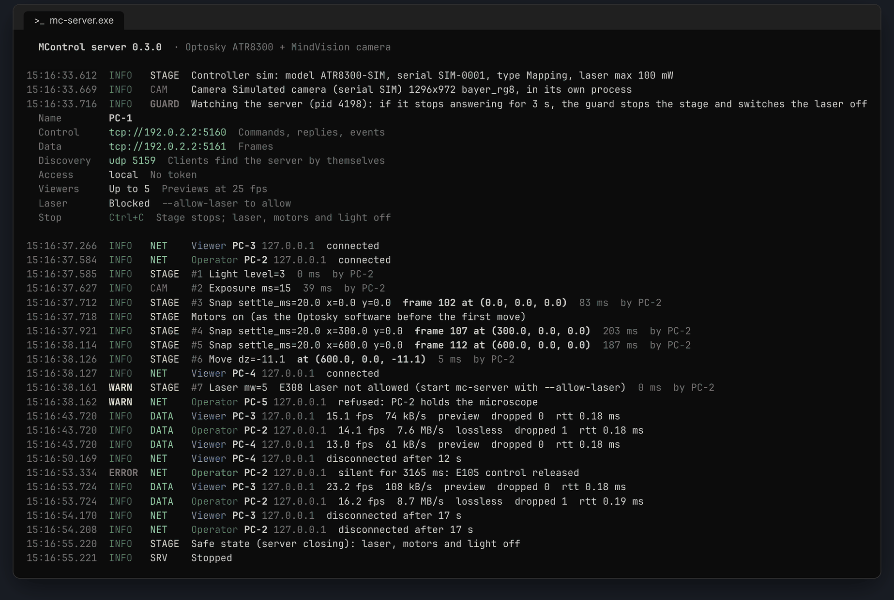
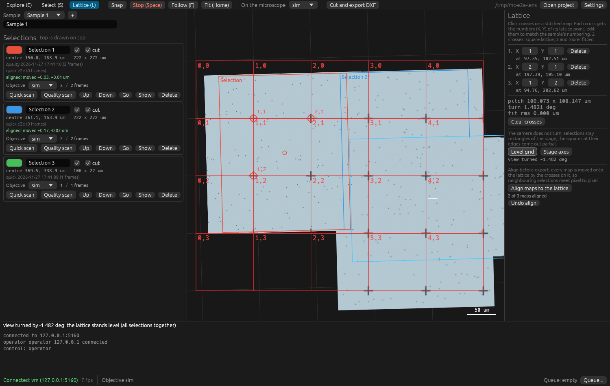
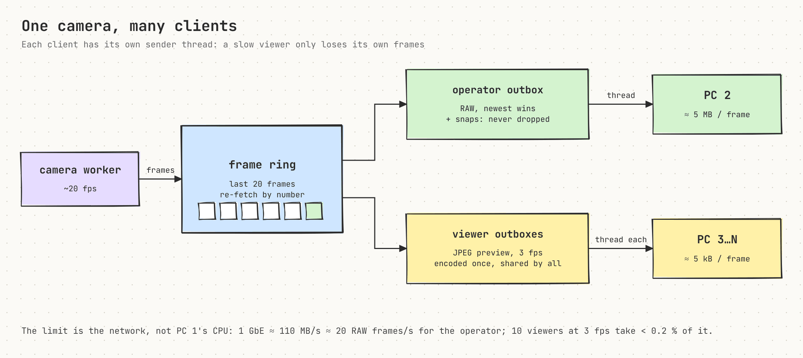
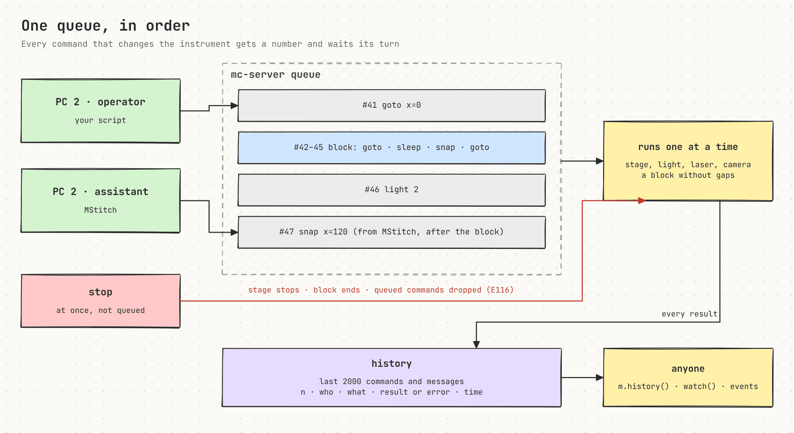
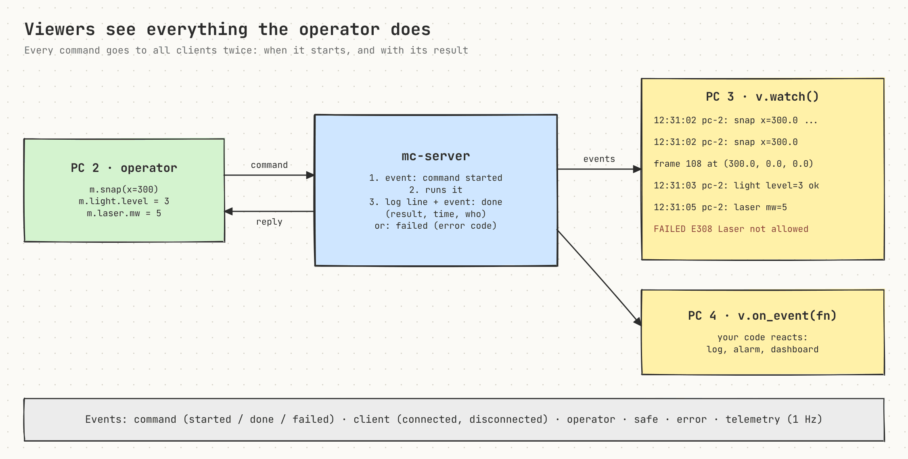
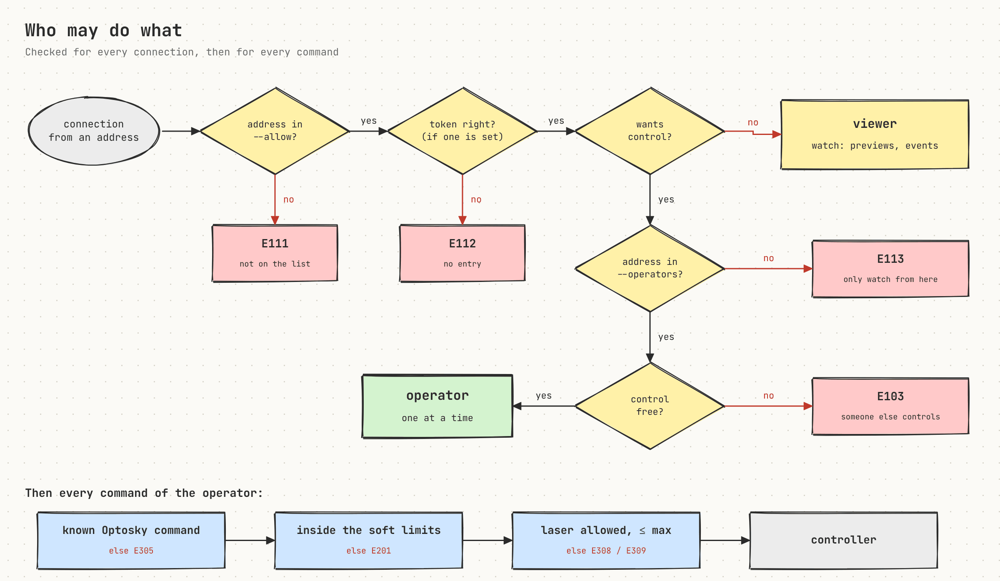

# MControl

Control an **Optosky ATR8300** microscope (stage, focus, light, laser, TEC) and its **MindVision** camera over the network, from Python.


* **One exe** on the microscope PC, nothing to install there apart from the MindVision SDK. A colour log shows who is connected and what is sent.
* **Full resolution, fast.** Bayer frames go out without colour conversion; PC 1 only packs them (lossless, or JPEG when the link is slow) so even a weak cable gives 10–20 fps. Each frame carries the stage position at mid-exposure and the time on the shared clock.
* **One operator, many viewers.** The operator holds a lease. Viewers are read-only and get JPEG previews at up to 30 fps (25 by default), encoded once per frame and shared by all of them; 5 viewers at a time by default (`--max-viewers`). Every action of the operator is sent to all clients as an event, so viewers see what is done, by whom, and what came out.
* **Local network by default.** Only local addresses may connect unless you say otherwise; see [Network and security](#network-and-security).
* **Keeps its devices.** While it runs, PC 1 holds the controller and the camera: the controller is checked every 2 s and reopened if the cable was pulled or it was switched off and on (light and motors come back, the laser stays off); a camera that stops sending frames is opened again with the operator's exposure and gain; Windows is kept from sleeping. For USB devices that doze off, switch off *USB selective suspend* in the Windows power plan.
* **Safe.** If the operator goes silent, the stage stops and the laser goes off. A separate guard process does the same over COM if the server itself hangs or dies.
* **Stable client.** The Python client finds the server and remembers it, and reconnects by itself. It repeats a command after a reconnect only when repeating is harmless (`goto`, settings, reads); relative moves are never repeated.

## Quick start

**PC 1: the microscope PC**
1. Install the MindVision SDK (`MindVision Platform Setup`, <https://www.mindvision.com.cn>).
2. Close the Optosky software: it holds the COM port and the camera.
3. Download `mc-server.exe` from [Releases](../../releases) and run it:
   ```
   mc-server.exe                  # finds the controller on its own
   mc-server.exe --port COM4      # or name the port
   mc-server.exe --sim            # simulator, no hardware
   mc-server.exe --help
   ```
   Ctrl+C stops it. Before exiting it stops the stage and switches off the laser, motors and light.

   

**PC 2: the operator** (with [uv](https://docs.astral.sh/uv/))
```
git clone https://github.com/andryushonny/MControl && cd MControl
uv sync                                    # .venv with mcontrol + numpy, pillow, jupyter, pytest
uv run jupyter lab example.ipynb            # the walk-through
uv run python my_script.py                 # your own scripts
```
To use it from another uv project: `uv add "mcontrol @ git+https://github.com/andryushonny/MControl"`.
```python
from mcontrol import Microscope

with Microscope() as m:                 # finds the server on the LAN, remembers it
    m.light.level = 3
    m.camera.exposure_ms = 15
    f = m.snap(x=300, y=0, settle_ms=30)   # move, wait until still, a fresh frame
    print(f.xyz_um, f.moving, f.settled_ms)
    img = f.rgb()                          # numpy HxWx3 (f.raw() = sensor data)
    f.save("tile.png")                     # + tile.json with all metadata
```
The full walk-through is in [`example.ipynb`](example.ipynb): stage, light, camera, snap, grid scan, live stream, events, viewers, errors.

## Web page

`mc-server.exe` also serves a page for anyone in the lab: open `http://<PC 1 address>:8080` (the banner shows it) on a computer, laptop or tablet. It shows the live picture, what the operator's program is doing (state, progress, time left, when it finished), who operates from which PC, the project, sample and objective, the stage, light and laser, and the last 10 commands. Read only; each open page takes one viewer place (`--max-viewers`). `--web-port N` to change the port, `--no-web` to switch it off.

## mc-operator: the program on PC 2

`mc-operator.exe` from [Releases](../../releases): the map of the stage with the live picture, selections, scans stitched by [MStitch](https://github.com/andryushonny/MStitch), the lattice of crosses, cutting into squares and the DXF for AutoCAD. Rust, the GPU draws (wgpu: DirectX 12 / Vulkan; `MC_RENDERER=glow` for old OpenGL-only PCs); stitched maps of 10 000+ px are drawn from 512 px tiles at the level the zoom needs.



**Flat field** (Calibrate menu): the frame darker to its edges (vignetting) is measured on an even part of the substrate (9 frames, half a field apart) and divided out of live pictures and scans, per objective.

**Keys** (top bar): a table of every action and its key; *Change* and press any key (Shift / Ctrl with it if wanted), *None*, *Default*; clashes are red; kept for next time.

**Controls** (top bar): turn and mirror the picture on the screen to your liking; teach the arrows by watching the stage (it moves a little along X, then Y, and you click where you saw it go), so each arrow moves the stage the way it points for you; find the camera's orientation.

How a session goes:
1. **Look around.** Arrows move the picture that way on the screen (Shift: a tenth, Ctrl: a whole field), a double click moves the stage there, the wheel zooms. Wherever the camera stood still a small copy stays on the map (the preview map).
2. **Select** (S): two clicks are the corners of a rectangle, snapped to the motor step. While drawing it shows how many frames it takes with the objective on the microscope; a selection over the limit is refused. Each selection has its objective, its centre, a colour; the list is the drawing order (top on top).
3. **Scan.** *Quick scan* / *Quality scan* put it in the **queue**: one scan on the microscope at a time, the previous one stitching beside it (MStitch, quick or quality mode), each map shown as soon as it is stitched. The queue is grouped by objective: the scans for the objective on the microscope go first, then it stops once and asks for the next objective (*20x is on: continue*). Limits, with the overlap: **quick ≤ 1200 frames, quality ≤ 225**.
4. **Lattice** (L): click 2–3 crosses on a stitched map; each is found to a tenth of a pixel; sign each with its (X, Y) from the sample. 2 crosses: square lattice; 3 and more: fitted, with the residual. The red lattice is drawn over everything, with the numbers in the top left corner of each square (the number of the cross there), once 2 crosses are signed. **Level grid** turns the view (all selections together) so the lattice stands level; the camera does not turn, so selections stay rectangles of the stage and the squares at their edges come out partial.
5. **Align maps to the lattice**: each map is stitched on its own and placed by the stage, a few µm off; Align finds every lattice cross on it and moves it onto the lattice (shift, or shift, turn and scale), so neighbouring selections meet pixel to pixel.
6. **Cut and export DXF**: every ticked selection with a stitched map is cut along the lattice into squares (PNG, transparent where the selection or its map ends), all on the same lattice: a layer cake of squares, one layer per selection in the order of the list, plus the lattice and its numbers. `drawing.dxf` (AutoCAD 2010, µm) references the squares next to it.

**Focus while scanning.** Every frame gets a sharpness (variance of the Laplacian over the squared brightness). A frame much less sharp than the last sharp ones is looked for in z: ±5 µm, then ±10, ±20, ±50 and only then ±100; once one is sharper the stage goes on that way and the step is halved down to 2.5 µm; if nothing is sharper (a plain spot) the frame stays where it was. Every frame's x, y, z and sharpness are kept: `focus.csv` by each scan and `surface.csv` for the project, the surface of the sample; the next frame starts from the plane through the points so far. Settings: on/off, how blurred is blurred, how far it may go.

Status bar: the link, the objective, the scan running with frames done and time left, the stitching, the queue and when everything will be done. *Stop* (Space) stops the stage and the scan and pauses the queue.

**Optics, once per objective** (Settings → *Calibrate optics: Measure here*, on a spot with texture): nine frames, the stage moved by a third of the field between them, give the scale, the camera's turn and the **lens distortion** ($p = c + (q - c)(1 + k_1 r^2 + k_2 r^4)$). Frames are corrected before stitching (each Bayer plane on its own, so MStitch still gets raw frames), and so are the live picture and the preview.
**Camera** (Settings): exposure, gain, auto exposure; remembered per objective and set again when that objective is put on.
**White balance**: *Pick grey* and click something grey, or *Auto* from the live picture; it applies to the live picture, maps and squares, raw frames stay raw.

The command line is now `mc-cli.exe` (status, goto, snap, bench).

## How it works

**A snap** gives a still, fresh frame and says where the stage was:


**Frames** go from one camera to many clients without slowing each other down:



**Frame packing.** PC 1 packs full frames so that a slow link carries more. The client chooses with `Microscope(codec=...)`:

| codec | how | size of a 2592 × 1944 frame* | error | fps on 100 Mbit | fps on 1 GbE |
|---|---|---|---|---|---|
| `raw` | as the sensor gives it | 5.0 MB | none | 2 | 23 |
| `lossless` | same-colour neighbour difference + zstd | 2.8 MB | none | 4 | 40 |
| `jpeg` 92 | each Bayer colour plane as JPEG | 1.0 MB | ≈ 2.5 DN rms | 11 | camera limit |
| `jpeg` 85 | the same, quality 85 | 0.55 MB | ≈ 3 DN rms | 20 | camera limit |
| **`auto`** (default) | snaps and re-fetches **lossless**; live frames lossless, one step down (JPEG 92 → 85 → 75) when the link drops frames, back up when the better step fits | | snaps exact | 10–20 | 40 |

\* a real microscope frame with about 2 DN of sensor noise; the noise decides how small frames get. On PC 1 the packing takes about 5–20 ms per frame (lossless / JPEG planes in parallel); `mc-server codec-bench` measures it on your PC. `Frame.codec` says how a frame came, `Frame.exact` whether its pixels are the sensor's; `Frame.raw()` unpacks.

**One queue, in order.** Everything that changes the instrument goes into one queue on PC 1 and runs one command at a time, in the order it came, each with a number `#n`. A script is plain Python, one command per line, and each line waits for its result. Inside `with m.block():` nothing from another client (an assistant such as MStitch) gets between your commands. `stop` does not wait: the stage stops at once, a block ends and what waits behind it is dropped (E116). Reads (status, camera state, history) are not queued.



```python
frames = []
for y in range(0, 900, 300):
    for x in range(0, 900, 300):
        with m.block():                 # nothing from anyone else between these lines
            m.goto(x=x, y=y)
            m.sleep(0.05)               # let it settle
            frames.append(m.snap())

for e in m.history(limit=20):           # what was done, by whom, in which order (the server keeps 2000)
    print(describe(e))                  # 14:02:11  #41 PC-2: snap  frame 512 at (300.0, 0.0, 0.0)  (83 ms)
m.queued()                              # what still waits
```

**Assistant and messages (for MStitch).** A program next to the operator's script, such as the stitcher, joins as an `Assistant`: it has the operator's rights and puts its commands into the same queue, while that operator holds control. On the operator's PC it joins without a key; on another PC it needs the operator's `m.lease_key`. Clients can also send each other messages through the server and wait for an answer:

```python
# MStitch (on PC 2)                                   # the operator's script
a = Assistant(name="MStitch")                         @m.on_message
f = a.snap(x=120)                  # act itself       def handle(msg):
ans = a.request("operator",                               if msg["data"]["want"] == "reshoot":
                {"want": "reshoot", "x": 120})                f = m.snap(x=msg["data"]["x"])
new = a.fetch(ans["seq"])          # the new frame            m.reply(msg, {"seq": f.seq})
```

**Events**: every viewer sees what the operator does, live:



```python
from mcontrol import Viewer
Viewer().watch()          # prints every operator action, like the server log
```

## Python API

| Object | What |
|---|---|
| `Microscope(codec="auto")` | full frames: `auto`, `lossless`, `jpeg` (with `quality=`), `raw`; see Frame packing |
| `Microscope()` / `Microscope("192.168.1.50")` | operator. Without an address: `MCONTROL_HOST`, then the last server used, then LAN discovery |
| `Viewer(fps=25)` | read-only: previews (`live()`, `latest()`), events, `fetch()` = one full frame per second |
| `Microscope(token="...")` | only when the server asks for a token (or `MCONTROL_TOKEN`); remembered per server |
| `m.stage` | `position`, `goto(x,y,z)`, `move(dx,dy,dz)`, `stop()`, `zero()`, `confirm()`, `motors(on)` |
| `m.camera` | `exposure_ms`, `gain`, `auto_exposure(on)`, `white_balance()`, `state` |
| `m.light.level` | 0..5 |
| `m.laser.mw`, `m.laser.off()` | needs `mc-server --allow-laser` |
| `m.cooler` | `on(bool)`, `temperature` |
| `m.snap(...)` | `x/y/z` absolute or `dx/dy/dz` relative, `settle_ms`; returns a `Frame` |
| `m.live(seconds=, count=, fps=)` | live frames while you loop: `for f in m.live(seconds=5): ...` |
| `m.latest()`, `m.fetch(seq)` | the newest frame; a re-fetch from the server ring |
| `m.goto(x, y, z)`, `m.move(dx, dy, dz)`, `m.sleep(s)`, `m.snap()` | the everyday commands, one per line, each in its turn |
| `with m.block():` | the commands inside run with nothing from other clients between them |
| `m.history(limit, since)`, `m.queued()` | the server's record of commands and messages; what still waits |
| `Assistant(name=, lease_key=)` | a helper with the operator's rights, through the same queue (MStitch) |
| `send(to, data)`, `on_message(fn)`, `request(to, data)`, `reply(msg, data)` | messages between clients: `"operator"`, `"all"` or a name |
| `m.on_event(fn)`, `m.watch()` | events: every operator command (started / done / failed, with result), clients, telemetry (1 Hz), errors; `watch()` prints them as lines |
| `Frame` | `raw()`, `rgb(full=False)`, `save()`, `meta`, `xyz_um`, `moving`, `settled_ms`, `t_local_ns`, `age_ms`, `codec`, `exact` |

## Network and security

The emphasis is the local network; reaching the microscope from outside is possible, with care.

| Option on PC 1 | What |
|---|---|
| `--bind 192.168.1.10` | listen only on this address (a dedicated network card, or a VPN address). Default: all |
| `--control-port`, `--data-port` | 5160 and 5161 by default. If a port is busy, the server takes the next free one of the 9 after it and says so; discovery tells clients the real ports |
| `--discovery-port`, `--no-discovery` | UDP 5159 by default. Without discovery clients give the address: `Microscope("192.168.1.10:5160")` |
| `--allow LIST` | who may connect: `local` (default: loopback, 10/8, 172.16/12, 192.168/16, 169.254/16, 100.64/10, IPv6 local), `any`, addresses, ranges `203.0.113.0/24` |
| `--operators LIST` | who may take control (default: same as `--allow`); everybody else can only watch |
| `--max-viewers N`, `--viewer-fps F` | viewers at the same time (default 5) and their preview rate (default 25, at most 30) |
| `--token TEXT` | shared secret (or env `MC_TOKEN`). Required when `--allow` goes beyond local networks: the server refuses to start otherwise (E121) |

Options can live in `mc-server.conf` next to the exe, one per line, so nobody types them twice:
```
bind = 192.168.1.10
operators = 192.168.1.20
allow-laser = false
```

**From outside the lab.** The safest way: a VPN (WireGuard, Tailscale, ZeroTier). The server stays "local only", the remote PC gets a VPN address (Tailscale's 100.64/10 already counts as local), nothing is opened to the Internet. Forwarding ports on the router with `--allow any --token ...` also works, but the traffic is not encrypted: the token and the frames cross the Internet in clear text, so prefer the VPN.



**What protects the instrument**
* Only addresses in `--allow` get an answer; only addresses in `--operators` may control; a token if set; one operator at a time.
* The controller only receives the known Optosky commands (E305 for anything else), stage moves stay inside the soft limits, the laser is blocked unless the server is started with `--allow-laser`, and never above the controller's maximum.
* Operator silent for 3 s: stage stops, laser off. Server hung: the guard process does the same over COM.
* Session ids are random, commands are limited to 64 kB, viewers are limited in number (`--max-viewers`, 5) and in full-frame requests.


## Errors

Each error is an `McError` with a `code`; the server log shows the same codes. Generated by `mc-server errors`:

| Code | Where | Message | What to do |
|---|---|---|---|
| E100 | net | Unknown command | Check the command name; client and server versions should match |
| E101 | net | Bad request | A value is missing or out of range: see the detail after the message |
| E102 | net | Read-only: viewers cannot control the microscope | Connect as operator |
| E103 | net | Another operator holds the microscope | Wait until it disconnects or releases control |
| E104 | net | Say hello first | Client bug: the first message must be hello |
| E105 | net | Operator silent too long: stage stopped, laser off | Check the network; the client reconnects by itself |
| E106 | net | Unknown session for the data connection | Open the control connection first; the client does this by itself |
| E107 | net | Frame no longer in the ring | Ask sooner, or start the server with a larger --ring |
| E108 | net | Too many requests | Viewers may fetch one full frame per second |
| E109 | client | No reply from the server in time | Check that the server runs and the network is up |
| E110 | client | Connection to the server lost | The client reconnects by itself; check the state before repeating a relative move |
| E111 | net | Address not allowed | Add the client's address or network to --allow on the server |
| E112 | net | Wrong or missing token | Give the server's token: Microscope(token=...) or MCONTROL_TOKEN |
| E113 | net | Control not allowed from this address | Connect as viewer, or add the address to --operators on the server |
| E114 | net | Too many viewers | Close a viewer, or start the server with a larger --max-viewers |
| E115 | net | Cannot join: no operator, or a wrong lease key | Start the operator first; give its lease_key, or run the assistant on the operator's PC |
| E116 | net | Cancelled by stop | Send the command again if it is still wanted |
| E117 | net | Queue full | Wait for the queued commands to finish |
| E120 | net | Cannot listen on this address or port | Another program uses the port, or the --bind address is not on this PC |
| E121 | net | Open beyond the local network without a token | Give --token, or keep --allow to local networks |
| E201 | stage | Outside the soft limits | Stay inside the stage range (mc-server --help shows the limits) |
| E202 | stage | Limit switch reached | Move back the other way; check the zero |
| E203 | stage | Move stopped | Someone sent stop, or the operator was lost; move again |
| E205 | stage | Z move too large for one command | Split the Z move into smaller steps |
| E300 | controller | Controller not connected | Plug in the USB cable, or give --port COMx |
| E301 | controller | No answer from the controller | Close the Optosky software, replug the USB, power-cycle the controller |
| E302 | controller | Bad reply from the controller | Usually noise on the line: repeat; replug if it stays |
| E303 | controller | Checksum error | Usually noise on the line: repeat; replug if it stays |
| E304 | controller | Reply to another command | Repeat; another program may be using the port |
| E305 | controller | Command not allowed | Only the known Optosky commands are sent to the controller |
| E306 | controller | Controller reports a failure | Check the motors and the cable; power-cycle the controller |
| E307 | controller | Serial port error | Replug the USB; check the port in Device Manager |
| E308 | controller | Laser not allowed (start mc-server with --allow-laser) | Start the server with --allow-laser |
| E309 | controller | Laser power above the maximum | Ask for no more than the maximum the controller reports |
| E500 | camera | Camera not available | Wait a few seconds after start; see the CAM lines in the server log |
| E501 | camera | No camera found | Plug the camera into USB 3; check it in MindVision's demo program |
| E502 | camera | MindVision camera SDK not found: install it from mindvision.com.cn (Downloads -> SDK) | Install the MindVision SDK, or give --sdk DIR |
| E503 | camera | Camera SDK error | Replug the camera; restart the server |
| E504 | camera | Camera used by another program (close the Optosky software) | Close the Optosky software and MindVision's demo |
| E505 | camera | No frame from the camera | Check the cable and the exposure; the worker restarts by itself |
| E506 | camera | Camera worker stopped | It restarts by itself; if it repeats, replug the camera |
| E600 | guard | Server not answering: guard stopped the stage and switched the laser off | Start mc-server again; look at the log for why it hung |

## Protocol (for other languages)
* **Control** on TCP 5160: messages `[u32 LE length][u8 kind=1][JSON]`. First `{"cmd":"hello","role":"operator"|"viewer","name":...,"token":...}`, then `{"cmd":..., "id":n, ...}` → `{"id":n,"ok":true,...}` or `{"ok":false,"error":{"code","msg"}}`. Events come as `{"event":...}`.
* **Data** on TCP 5161: `{"session":..., "want":"raw"|"preview", "codec":"auto"|"lossless"|"jpeg"|"raw", "quality":92}`, then frames `[len][kind=2][u32 header length][header JSON][payload]`. The header's `codec` says how the payload is packed: `lossless` = zstd of the difference to the same-colour pixel two to the left (first two columns: two rows up), wrapping; `jpeg` = 4 × `[u32 length][JPEG]` for the Bayer planes (x, y) = (0,0), (1,0), (0,1), (1,1).
* **Discovery**: UDP broadcast `MCONTROL?` to port 5159; the answer has the name, the real ports and whether a token is needed.
* **Events**: `command` (`state`: queued / started / done / failed, `n`, `step`, `by`, `cmd`, `args`, `result`, `ms`), `message`, `client`, `operator`, `safe`, `error`, `telemetry`.
* **Queue**: replies to queued commands carry `n`. `begin` … `end` = a block (only this client's commands run in between); `sleep` = `{"cmd":"sleep","ms":50}`; `history` = `{"since":n,"limit":100}` → `{"history":[...],"queued":[...]}`; `send` = `{"to":"operator","data":{...},"reply_to":n}`. Role `assistant` joins with `"join": lease_key` (or from the operator's own address).
* **Clock**: `ping {t1}` → `{t1,t2,t3}`. The offset comes from the sample with the smallest round trip among the last 32.

## Build and test
```
cargo build --release                 # target/release/mc-server(.exe), mc-operator (the program), mc-cli, mc-viewer
uv run pytest                         # integration tests on the simulator
python docs/diagrams/render.py        # the pictures in this README (node + Chrome)
```
Windows binaries are built by GitHub Actions on every push; a new version in Cargo.toml on main becomes a release with them (see CHANGELOG.md).
